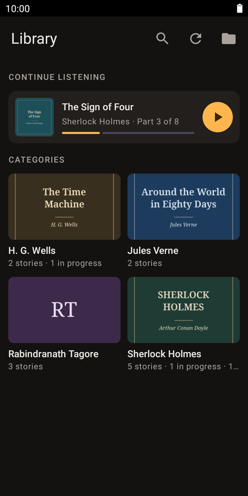
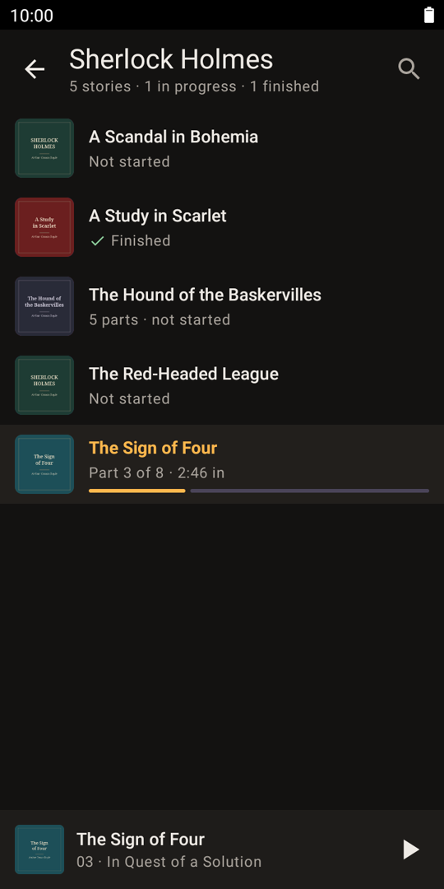
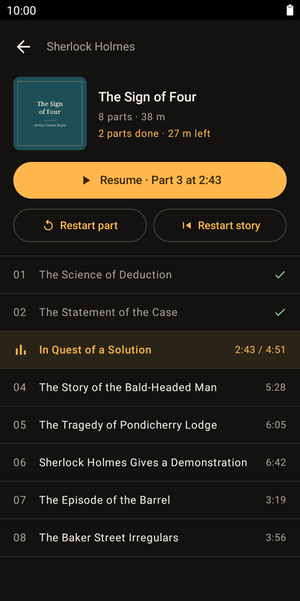
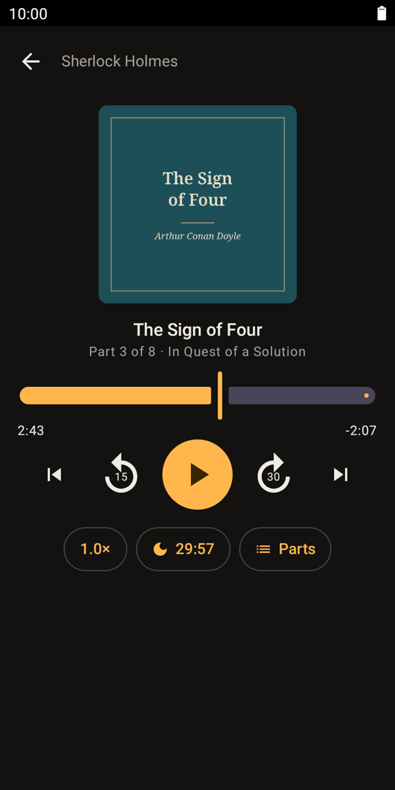
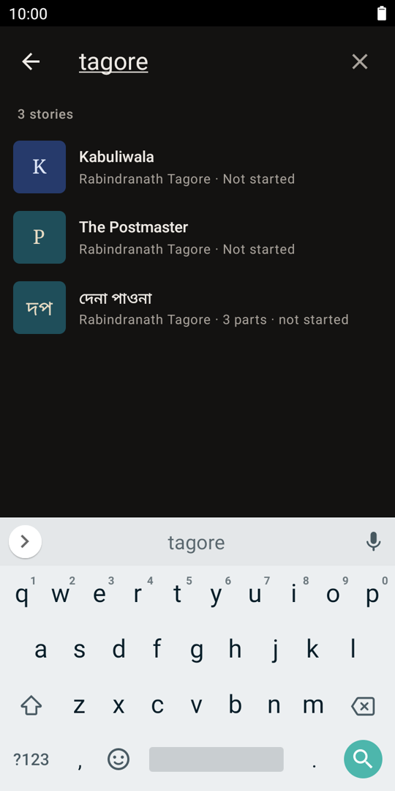

# Lauschter – Audiobook Player

**Lauschter** (Luxembourgish for *listen*) is a simple, offline audiobook and radio-drama player for Android. It's made for digital audio players like the **FiiO M11S**, and should work on most Android phones too.

Point it at a folder of audiobooks. It shows your categories and stories with their covers, remembers exactly where you stopped in every story, and keeps playing with the screen off.

<p align="center">
  
  
  
  
  
</p>

*Screenshots use public-domain titles and generated covers.*

## Features

- **Your own files, fully offline.** No account, no streaming, no ads. The app doesn't even ask for internet access.
- **Library → category → story → parts.** For example *Sherlock Holmes → The Sign of Four → 8 chapters*. Covers come from the folder (`cover.jpg`), from the audio file, or are generated.
- **Remembers your place in every story,** down to the second. Tap **Resume** to carry on.
- **Restart part** or **Restart story** (the second asks first, so your place is never lost by accident).
- **Continue listening** card on the home screen.
- **Plays in the background** with a notification. The player's hardware buttons (play/pause, next/previous) work, and it pauses when headphones are unplugged.
- **Skip back 15 s / forward 30 s,** previous/next part, seek bar.
- **Playback speed** 0.75× – 2×.
- **Sleep timer** (10 – 90 min), which keeps counting even if you close the app.
- **Search** all stories, or within one category, by title or author. Works with English and Bengali titles.
- **Clean titles:** track numbers, repeated category names and clutter are hidden (your files are never renamed).
- **Formats:** MP3, M4A, M4B, AAC, FLAC, OGG, Opus, WAV.

## Download and install

1. Download the APK: **[Lauschter-0.4.0.apk](https://github.com/ghoshm21/lauschter/raw/main/apk/Lauschter-0.4.0.apk)** (it's also in the [`apk`](apk) folder of this repository and under [Releases](https://github.com/ghoshm21/lauschter/releases)).
2. Copy it to your player or phone (USB file transfer, or straight into the `Download` folder).
3. On the device, open the APK with a file manager (e.g. *Files by Google*). If asked, allow that app to *install unknown apps*.
4. Tap **Install**, then **Open**.
5. Allow access to your audio files, choose the folder that holds your audiobooks, and tap **Use this folder**.

Requires Android 5.0 or newer. Tested on the FiiO M11S (Android 10).

To update, install the newer APK over the old one; your bookmarks are kept.

## How to arrange your audiobooks

Make one folder per **category**, and inside it one folder per **story**:

```
Audiobooks/                         ← choose this folder in the app
  Sherlock Holmes/                  ← category (optional cover.jpg)
    The Sign of Four/               ← story
      cover.jpg                     ← optional
      01 The Science of Deduction.mp3
      02 The Statement of the Case.mp3
    A Study in Scarlet/
      CD1/ …                        ← CD1, CD2, Disc 1, Part 1 folders become one story
      CD2/ …
  Radio Dramas/
    Some Drama/
      Some Drama.mp3                ← a story can be a single file
  Single File Story.m4b             ← loose files appear under "Other stories"
```

- Parts play in name order, and numbers sort naturally (2 before 10).
- A story can have one file or hundreds.
- Folders without audio (e.g. `Artwork/`, `Scans/`) are ignored.
- Tap ↻ on the Library screen to rescan after adding books.

## Good to know

- **WMA / APE files** usually can't be played by Android; the app tells you when a file isn't supported. Convert them to MP3 or FLAC.
- **DRM-protected audiobooks** (e.g. Audible `.aa` / `.aax`) can't be played.
- **M4B chapters:** an M4B file currently plays as one long part, without its internal chapter list.
- **Bookmarks follow the folder path:** renaming or moving a story's folder starts that story from the beginning.

## Privacy

Lauschter has no internet permission, no analytics and no accounts. It reads your audio files and remembers your place in each story, all on the device.

| Permission | Why |
|---|---|
| Read audio files / storage | To find and play your audiobooks |
| Read images | To show `cover.jpg` files from your folders |
| Foreground service, wake lock, notifications | To keep playing with the screen off and show the player notification |
| View network state | Added by the media library; it can't send or receive data |

## About

A personal project, built for listening to audiobooks and Bengali radio dramas on a FiiO M11S. Released under the [MIT License](LICENSE).
